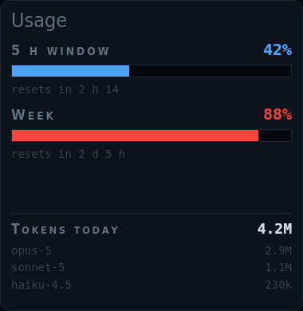
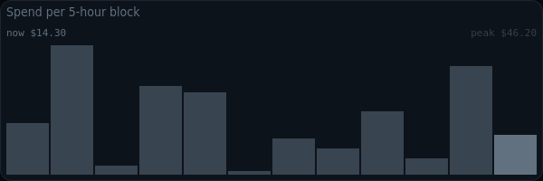

# kiosko-plugin-usage

How much Claude Code you are burning, from ccusage: limit windows or spend, tokens by model, spend per block.

A plugin for [Kiosko](https://github.com/kiosko-lcd/kiosko), the widget mosaic for small USB LCD panels.



## Install

In Kiosko, **Plugins → Install from npm** → `kiosko-plugin-usage`, then restart Kiosko. Or from a terminal:

```sh
npm install --prefix ~/.config/kiosko/plugins kiosko-plugin-usage
```

(macOS: `~/Library/Application Support/Kiosko/plugins`, Windows: `%APPDATA%\Kiosko\plugins`.)

## Requirements

- [`ccusage`](https://github.com/ryoppippi/ccusage) on the `PATH` (`npm install -g ccusage`).

## Widgets

### Usage — `usage/rail`

Limit windows (or spend against your caps) as bars with their reset time, and today’s tokens by model.


Uses: `usage/ccusage`.

| Option | Type | Default | |
|---|---|---|---|
| `bars` | number | `2` | Bars |
| `models` | number | `3` | Models listed. 0 = only today's total. |
| `warn` | number | `60` | Amber from. How full a bar is. |
| `alert` | number | `85` | Red from |

### Spend per 5-hour block — `usage/blocks`

The equivalent cost of the last 5-hour blocks (twelve by default), the running one highlighted: is today unusual?



Uses: `usage/ccusage`.

| Option | Type | Default | |
|---|---|---|---|
| `blocks` | number | `12` | Blocks shown. 12 = two and a half days; 48 = ten. |

## Data sources

### Claude Code usage (ccusage) — `usage/ccusage`

Runs ccusage, every minute by default and never more often. Each run walks the whole Claude Code history (a few seconds of CPU). Read every 1 min while a widget uses it. Options are set once in Kiosko → Settings → Data sources.

| Option | Type | Default | |
|---|---|---|---|
| `bin` | string | `"ccusage"` | ccusage command. Looked up in PATH unless it is a full path. May carry arguments, e.g. "npx ccusage". |
| `mode` | `max` \| `api` | `"max"` | Plan |
| `dailyCap` | number | `25` | Daily cap (API) |
| `monthlyCap` | number | `400` | Monthly cap (API) |
| `calibration.metric` | `cost` \| `tokens` | `"cost"` | Measure |
| `calibration.lookbackDays` | number | `30` | Days of history (0 = all) |
| `calibration.percentile` | number | `100` | Percentile that marks 100 % |

## Development

```sh
npm install
npm test          # node:test
npm run check     # TypeScript
npm run build     # dist/index.js, what Kiosko loads
```

To try it in a running Kiosko without publishing: `kiosko plugins link .` and restart Kiosko.

Working on Kiosko and its plugins together: clone them side by side
(`kiosko/` and `kiosko-plugins/kiosko-plugin-usage/`) and run `npm install` in
`kiosko/`; its workspaces link every plugin found in `../kiosko-plugins`.

## License

MIT
