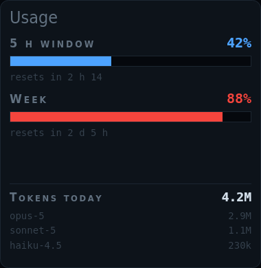
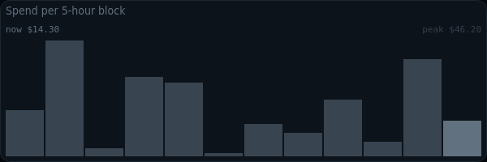
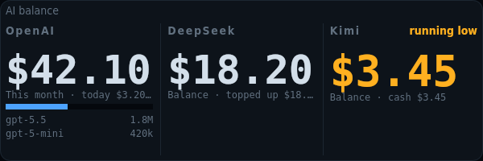
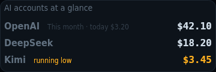
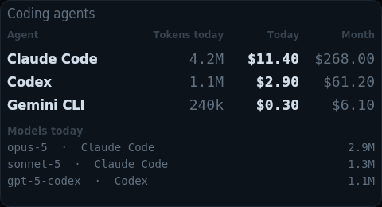

# kiosko-plugin-usage

What your AI costs: DeepSeek and Kimi balances, OpenAI spend, and the coding agents on this machine (Claude Code, Codex, Kimi CLI, Qwen Code…) from ccusage.

A plugin for [Kiosko](https://github.com/kiosko-lcd/kiosko), the widget mosaic for small USB LCD panels.



## Install

In Kiosko, **Plugins → Install from npm** → `kiosko-plugin-usage`, then restart Kiosko. Or from a terminal:

```sh
npm install --prefix ~/.config/kiosko/plugins kiosko-plugin-usage
```

(macOS: `~/Library/Application Support/Kiosko/plugins`, Windows: `%APPDATA%\Kiosko\plugins`.)

## Requirements

- For `usage/ccusage` and `usage/agents`: [`ccusage`](https://github.com/ccusage/ccusage) on the `PATH` (`npm install -g ccusage`); `usage/agents` needs ccusage 20 or newer.
- For `usage/accounts`: an API key of each provider you want to see (see *Providers* below). Nothing is asked of a provider without a key.

## What it does on your machine

- **Internet**: contacts `api.deepseek.com`, `api.moonshot.cn`, `api.moonshot.ai`, `api.openai.com`.
- **Runs**: `ccusage`.

## Widgets

### Usage — `usage/rail`

Limit windows (or spend against your caps) as bars with their reset time, and today’s tokens by model.


Uses: `usage/ccusage`.

| Option | Type | Default | |
|---|---|---|---|
| `bars` | number | `2` | Bars |
| `models` | number | `3` | Models listed. 0 = only today's total. |
| `warn` | number | `60` | Amber from. How full a bar is. |
| `alert` | number | `85` | Red from |

### Spend per 5-hour block — `usage/blocks`

The equivalent cost of the last 5-hour blocks (twelve by default), the running one highlighted: is today unusual?



Uses: `usage/ccusage`.

| Option | Type | Default | |
|---|---|---|---|
| `blocks` | number | `12` | Blocks shown. 12 = two and a half days; 48 = ten. |

### AI balance — `usage/balance`

What is left on each AI account (DeepSeek, Kimi) in its own currency, amber when it runs low; OpenAI’s spend this month against your budget.



Uses: `usage/accounts`.

| Option | Type | Default | |
|---|---|---|---|
| `models` | number | `2` | Models listed. Today’s tokens by model, where the provider gives them (OpenAI). |

### AI accounts at a glance — `usage/summary`

One line per AI account: its balance or this month’s spend, and a word when it runs low or can’t be read. For narrow strips.



Uses: `usage/accounts`.

*No options.*

### Coding agents — `usage/agents`

Each coding agent on this machine (Claude Code, Codex, Kimi CLI, Qwen Code…): tokens and equivalent cost today, cost this month, and today’s models.



Uses: `usage/agents`.

| Option | Type | Default | |
|---|---|---|---|
| `models` | number | `3` | Models listed. Under the table, if there is room. |
| `month` | boolean | `true` | Show this month |

## Data sources

### Claude Code usage (ccusage) — `usage/ccusage`

Runs ccusage, every minute by default and never more often. Each run walks the whole Claude Code history (a few seconds of CPU). Read every 1 min while a widget uses it. Options are set once in Kiosko → Settings → Data sources.

| Option | Type | Default | |
|---|---|---|---|
| `bin` | string | `"ccusage"` | ccusage command. Looked up in PATH unless it is a full path. May carry arguments, e.g. "npx ccusage". |
| `mode` | `max` \| `api` | `"max"` | Plan |
| `dailyCap` | number | `25` | Daily cap (API) |
| `monthlyCap` | number | `400` | Monthly cap (API) |
| `calibration.metric` | `cost` \| `tokens` | `"cost"` | Measure |
| `calibration.lookbackDays` | number | `30` | Days of history (0 = all) |
| `calibration.percentile` | number | `100` | Percentile that marks 100 % |

### AI accounts (balance and spend) — `usage/accounts`

Asks each provider with a key for its balance or spend, every 5 minutes by default and never more often than every 2. A provider that fails waits longer before the next try (5 min, then 10, 20… up to an hour). Read every 5 min while a widget uses it. Options are set once in Kiosko → Settings → Data sources.

| Option | Type | Default | |
|---|---|---|---|
| `deepseek.apiKey` | string | *(secret)* | API key. From platform.deepseek.com → API keys. Mainland China and international use the same platform. |
| `deepseek.lowBalance` | number | `10` | Warn below. In the account’s own currency. 0 = never. |
| `kimi.apiKey` | string | *(secret)* | API key. From platform.kimi.com (mainland China) or platform.kimi.ai (international) → API keys. A key only works on its own platform. |
| `kimi.region` | `cn` \| `global` | `"cn"` | Platform |
| `kimi.lowBalance` | number | `10` | Warn below. In the account’s own currency. 0 = never. |
| `openai.adminKey` | string | *(secret)* | Admin key. An organization Admin key (platform.openai.com → Settings → Organization → Admin keys), not a project key. |
| `openai.monthlyBudget` | number | `0` | Monthly budget. Amber from 80 %, red from 100 %. 0 = no bar. |

### Coding agents usage (ccusage) — `usage/agents`

Runs ccusage 20 or newer once every 2 minutes by default (never more often than every minute): today and this month for each coding agent it finds on this machine (Claude Code, Codex, Kimi CLI, Qwen Code, Gemini CLI, OpenCode…). Costs are ccusage’s estimates in USD. Read every 2 min while a widget uses it. Options are set once in Kiosko → Settings → Data sources.

| Option | Type | Default | |
|---|---|---|---|
| `bin` | string | `"ccusage"` | ccusage command. Looked up in PATH unless it is a full path. May carry arguments, e.g. "npx ccusage@latest". |
| `offline` | boolean | `false` | Offline prices. Use the prices ccusage has cached instead of downloading them: for networks where GitHub is slow or blocked. |

## Providers

Three sources, each optional: place only the widgets you want, and fill in only the keys you have.

| Source | What it reads | Where | Mainland China |
|---|---|---|---|
| `usage/ccusage` | Claude Code from its local logs, through ccusage: limit windows or spend against caps, tokens by model, 5-hour blocks | this machine | — (Claude is not offered there) |
| `usage/agents` | every coding agent ccusage finds on this machine: Claude Code, Codex, **Kimi CLI**, **Qwen Code**, Gemini CLI, OpenCode, Copilot CLI… | this machine | yes (Kimi CLI, Qwen Code; turn on *Offline prices* if GitHub is slow or blocked) |
| `usage/accounts` | balances and spend from each provider's billing API, with your key | the provider | yes (DeepSeek, Kimi on platform.kimi.com) |

### Keys for `usage/accounts`

Kiosko → Settings → Data sources → *AI accounts*. Keys are stored as secrets: masked in the editor and never written to a log. Balances are read every 5 minutes by default (2 at the most); a provider that fails waits longer before the next try (5, 10, 20, 40 minutes, then hourly; an hour after a refused key) and keeps showing its last figure, dimmed, with the reason. Amounts are shown in the currency the provider gives (¥ for CNY in simplified Chinese, CN¥ elsewhere, US$ in Taiwan); nothing is converted.

- **DeepSeek** — [platform.deepseek.com](https://platform.deepseek.com) → *API keys*. One platform for mainland China and abroad; the balance is in CNY or USD, as topped up. API: [`GET /user/balance`](https://api-docs.deepseek.com/api/get-user-balance).
- **Kimi (Moonshot AI)** — mainland China: [platform.kimi.com](https://platform.kimi.com) (balance in CNY); international: [platform.kimi.ai](https://platform.kimi.ai) (USD). Pick the matching *Platform*: a key only works on its own. API: [`GET /v1/users/me/balance`](https://platform.kimi.com/docs/api/balance).
- **OpenAI** — an organization **Admin key** ([platform.openai.com](https://platform.openai.com) → Settings → Organization → Admin keys; a project key is refused). Shows this month's spend (UTC days) against an optional budget, and today's tokens by model. There is no API for the prepaid credit balance. APIs: [costs](https://developers.openai.com/api/reference/resources/admin/subresources/organization/subresources/usage/methods/costs), [completions usage](https://developers.openai.com/api/reference/resources/admin/subresources/organization/subresources/usage/methods/completions).

### Not included, and why

- **Qwen (Alibaba Cloud Model Studio / DashScope)**: no API returns the balance or the bill with a Model Studio API key; they are only in the console ([billing](https://help.aliyun.com/en/model-studio/bill-query-and-cost-management)). Qwen Code's own usage is in `usage/agents`.
- **Zhipu GLM (bigmodel.cn)**: its [API reference](https://docs.bigmodel.cn/llms.txt) has no balance or usage endpoint.
- **SiliconFlow**: its only balance endpoint, `/v1/user/info`, was [switched off on 2026-08-14](https://docs.siliconflow.cn/en/release-notes/overview) with no replacement yet.
- **Gemini API**: usage and billing are only in AI Studio and Cloud Billing ([billing](https://aistudio.google.com/docs/billing)); no key-based API. Gemini CLI's usage is in `usage/agents`.

## Development

```sh
npm install
npm test          # node:test
npm run check     # TypeScript
npm run build     # dist/index.js, what Kiosko loads
```

To try it in a running Kiosko without publishing: `kiosko plugins link .` and restart Kiosko.

Working on Kiosko and its plugins together: clone them side by side
(`kiosko/` and `kiosko-plugins/kiosko-plugin-usage/`) and run `npm install` in
`kiosko/`; its workspaces link every plugin found in `../kiosko-plugins`.

## License

MIT
